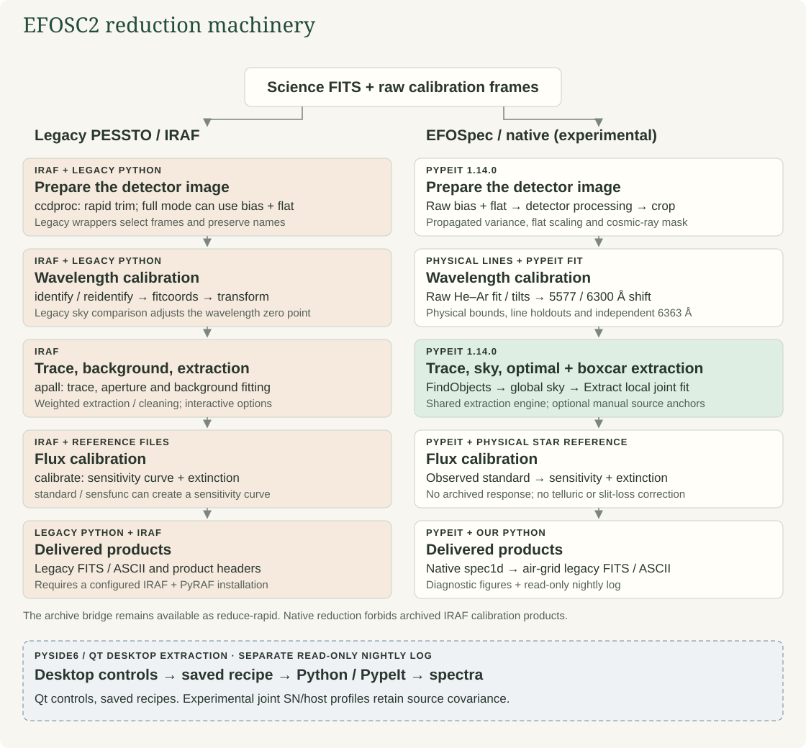

# Reduction machinery

- **Current workflow:** PypeIt extraction + archived-calibration bridge.
- **Supported demonstration:** EFOSC2 Gr11/Gr13, Free filter, 2×2 binning.
- **IRAF runtime:** used only by the legacy pipeline.
- **SOFI:** later migration phase.

## Engine boundaries

| Stage | Legacy pipeline | Current ePESSTO+ |
| --- | --- | --- |
| Inventory / naming | Legacy `ntt` helpers | Our Python / Astropy code |
| Detector preparation | IRAF `ccdproc`; rapid trim or full bias/flat | Our trim, gain conversion, target crop |
| Wavelength solution | IRAF identify/reidentify, fitcoords, transform | Our polynomial fit to archived IRAF IDs |
| Flexure | Legacy sky comparison / wavelength shift | Our 5577/6300 Å shift; independent 6364 Å check |
| Trace / background | IRAF `apall` | PypeIt `FindObjects` and `Extract` |
| Extraction | IRAF `apall` weights / cleaning | PypeIt optimal and boxcar extraction |
| Flux calibration | IRAF `calibrate`; standard/sensfunc when needed | Our archived sensitivity + La Silla extinction |
| Native output | IRAF multispec products | PypeIt `SpecObjs` spec1d FITS |
| Final output | Legacy FITS/ASCII and headers | Our air-wavelength resampling, FITS/ASCII, Fieldnotes |

## Important distinctions

- Legacy **full** and **rapid** reductions have different calibration policies.
- The current new runner implements **rapid** processing only.
- Both use legacy reference files; the new runner does not execute IRAF.
- Fully IRAF-independent calibration is still pending: [inputs and status](native-calibration.md).
- PypeIt supplies air/vacuum conversion utilities and extraction variances.
- Our exporter propagates diagonal variance; resampling covariance is not saved.
- Existing neighbour profiles are fitted together; only one selected target is exported.

## Current limits

- No fresh bias/flat/arc masters or standard-star sensitivity solution.
- No bias, flat, dark, overscan, or telluric correction in the new rapid path.
- Fringing remains; absolute flux and red second-order contamination need validation.
- Five demonstration targets use unverified nominal acquisition positions.
- No native spec2d product, full legacy parity, or Phase 3 certification.

## Read the diagnostic shading

- **Blue:** input sky pixels before iterative rejection.
- **Red:** geometric boxcar aperture, not optimal-extraction weights.
- **Opacity:** selected fraction within each wavelength bin.

## Code and next steps

- `rapid.py`: reduction orchestration and export.
- `archive_calibration.py`: wavelength, sensitivity, and resampling.
- `pypeit_adapter.py`: instrument metadata and parameters.
- `report.py`: offline webpage.
- [GUI and two-source extraction](roadmap/pypeit-migration/gui.md).
- [Legacy Python 3.11 compatibility check](legacy-compatibility.md).
- Rebuild the diagram: `python scripts/render_pipeline_diagram.py`.
